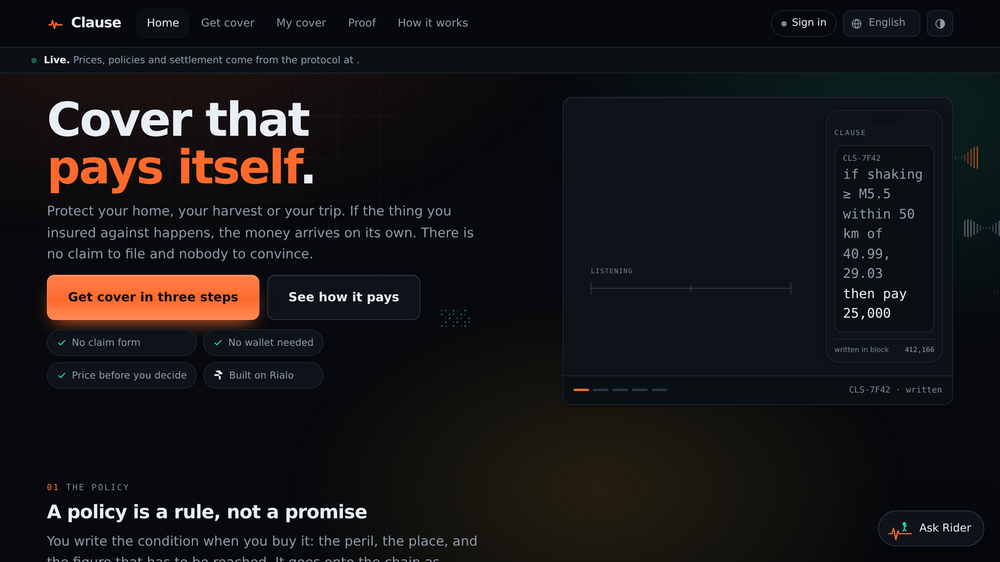
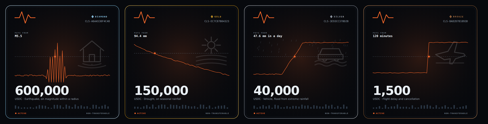

# Clause

**Parametric cover that settles itself, on Rialo.**

[](https://github.com/erkancamli/clause/actions/workflows/deploy.yml)
[](https://clause.insure)
[](CHANGELOG.md)
[](pyproject.toml)
[](site/i18n/)
[](docs/anchor.md)
[](LICENSE)

An insurance protocol where the policy is a subscription on chain. You buy cover
against a measurable event; the subscription listens to the topic that carries
that measurement; when the validators agree the index has crossed your trigger,
the payout runs in that block. No claim is filed, no adjuster is appointed, and
nobody decides whether you are paid.



Five perils ship in this build:

| Peril | Index | Source |
| --- | --- | --- |
| Earthquake | shaking intensity at the insured address, or the largest magnitude inside a radius | seismic catalogue and shaking maps, read through REX |
| Drought | cumulative rainfall over a growing season at a station | meteorological station, read through REX |
| Vehicle flood | one day's rainfall where the car is kept, against its return periods | meteorological reanalysis, read through REX |
| Storm | one day's wind where the home stands, against its return periods | meteorological reanalysis, read through REX |
| Flight delay | arrival delay in minutes for one flight | airline status feed, read through REX |

Behind them sits a real underwriting pool: capital from liquidity providers, an
actuarial pricing engine, a solvency standard, concentration limits that refuse
business the pool cannot carry, and a registry of licensed insurers that decides
where cover may lawfully be written.

Clause is not the insurer. It is a registry, a pricing engine, a pool of
capital and a settlement rail; the policy is issued by a company that holds a
licence in the buyer's country, and that company registers here and has its
licence checked by a person before it may write anything.

A deployment starts with an empty registry, so nothing can be written anywhere
until a real company registers. The stand in companies this build ships with
load only in a demonstration, alongside the pretend money and behind the same
switch. None of them has a name a real company could have, none carries
anything shaped like a licence number, and every one of them is marked as a
specimen in the API, on the coverage map, on the confirmation screen and on the
policy itself. An earlier version invented plausible insurers with references in
the exact format the regulator uses; that was published on a live public site,
and it is the one kind of falsehood this codebase exists to make impossible.

### The policy is a token, and the token is the policy

Each policy mints a non-transferable ERC-721 on Base Sepolia. The picture is not
the policy retyped: it is the index that cover watches, the level it has to
reach, and the moment the two meet, generated from the policy id and the hash of
the terms, so the drawing is a function of the contract rather than an ornament
laid on it. No two are alike. Behind each trace stands the thing insured, and a
tier names the band the cover falls in — the limit and nothing else, a grade of
size rather than of quality.



### Contents

- [What is actually here](#what-is-actually-here)
- [What a company gets for its paper](#what-a-company-gets-for-its-paper)
- [What a buyer can hold the protocol to](#what-a-buyer-can-hold-the-protocol-to)
- [A public chain beside the protocol's own](#a-public-chain-beside-the-protocols-own)
- [Deploy](#deploy)
- [Money in, and the chain it is on](#money-in-and-the-chain-it-is-on)
- [Running it](#running-it)
- [The test that matters](#the-test-that-matters)
- [The number that makes it insurance](#the-number-that-makes-it-insurance)
- [What is real and what is simulated](#what-is-real-and-what-is-simulated)
- [Layout](#layout)

---

## What is actually here

**Any coordinate in Türkiye is insurable.** Earthquake hazard is computed from a
surface built on the mapped fault systems, not from a list of cities. Distance to
the nearest trace is continuous, so every point has a hazard; a policy circle
intersects a *length* of fault, so the radius is a smooth lever rather than a
threshold; and the Marmara seismic gap is carried explicitly, so the buyer is
told why Istanbul costs more rather than only charged for it. Fifty eight
weather stations cover the agricultural regions.

**There is no list of countries in this protocol.** Where cover can be written
is a consequence of who has registered, not a table someone maintains. A company
registers with its licence, its authority, its perils, the kind of buyer it may
reach and what its licence lets it settle in. Somebody then checks that licence
number against the regulator's own register, because nothing here can read one
from inside a block, and only then may it write. The day a licensed insurer in
Japan registers, Japan works, and no code changes. The day its licence lapses,
matching stops in the same second, which is a thing a table in the source could
never do. A buyer somewhere nobody has registered is told exactly that: a fact
about this registry rather than about their country.

**Identity is proved, and never held.** Cover above a small size needs a verified
identity, and every policy anywhere needs the address screened against sanctions
lists. Clause does neither. A verifier the carrier already trusts does the
checking and signs a one line statement about the address; the buyer's device
holds the statement and presents it; this protocol checks the signature and
learns one bit. There is nowhere in an attestation to put a name, a document
number or a date of birth, and a test enforces that. A screening expires in
thirty days and the payout path re-runs the whole check, so a person added to a
list after binding is not paid by a protocol that stopped looking.

**Validators disagree, and the protocol says what happens then.** On Rialo each
validator performs a web call itself and its own answer lands on chain; the
reconciliation is delegated to an aggregator whose default rule is not published.
For an insurer that gap is fatal, because two seismic networks routinely publish
magnitudes a tenth apart and a policy attaching at 5.5 settles differently on
5.49 and 5.51. So Clause states its own rule as a term of the policy: at least
three of four validators must report, the settled figure is the median, and if
they disagree by more than five percent the reading is refused rather than
averaged. A refused reading is treated as one that never arrived, which is a case
this protocol already knows how to end.

**The proof is on chain, not in our files.** Every policy carries a lineage: the
subscription, the topic it listens to, every round of validator reports, what the
aggregator concluded about each, and the settlement transaction. The question an
insurer is normally asked to answer out of its own records is answered here from
what the chain stored, and the buyer can reconstruct it without this interface
through `get_subscription`, `get_triggered_transactions` and
`get_workflow_lineage`.

**You are charged the price you were shown.** A premium depends on the book,
and the book moves while a buyer is deciding, so the price is struck again when
the policy binds. That is correct and it is also a way to charge more than the
figure on the screen. The request that binds carries the most the buyer agreed
to pay; a price that has moved past it refuses the policy and takes nothing,
rather than writing cover at a number nobody saw.

**Identity is a key, not an account.** A key pair is generated on the buyer's
device and the private half never leaves it; the address is derived from the
public half. P-256, which is the curve platform authenticators sign with and the
curve behind Rialo's published `secp256r1` program, so a signature verified here
is one the chain could verify. There is no password, nothing to reset and no user
record. Every movement of value carries its own signature over its own terms, so
a captured request cannot be replayed as a larger policy.

**Compliance is a gate in the path, not a disclaimer.** Writing insurance without
a licence in Türkiye carries three to five years' imprisonment under Article 35
of Law 5684, and the 2021 central bank regulation prohibits settling in crypto
assets. So a Turkish policy is issued by a Turkish licensed insurer and settles
in lira, and both facts come from that insurer's registered licence rather than
from a paragraph in this codebase. Three tests bind everywhere and no licence
cures them: the thing insured must be inside the area the index measures, cover
is capped by the value declared at risk, and the payout cannot be discretionary.

Rialo publishes identity, privacy and compliance as a protocol level concern it
calls IPC, and the property it claims is the one this is built around:
*compliance is re-evaluated on every execution*, and a failure aborts rather
than being discovered afterwards. A carrier suspended by its own regulator, a
licence that lapsed, a screening that went stale: all of them stop the payout
here, because the gate runs again before the money leaves.

**The operator's own refusals are a rule in the path, not a note in a file.**
The compliance gate answers from the registry and the eligibility check from
what a buyer proved; neither can say "not this address, whatever it proves" or
"nothing on this fault this week". A policy pipeline, in the shape of the one
Rialo's Latch puts in front of a credential, can: a denylist of addresses,
wallets on other chains, countries and payout destinations, and moratoria on
a peril in a country or inside a circle until a date. Every stage that moves
value asks it (a purchase by any route, a payout leaving, a cashout, a
deposit, a wallet being linked); the first rule to deny stops it; every entry
carries a reason and who wrote it, and a lifted one stays in the book with who
lifted it. `POST /api/policy/check` returns the decision the real stage would
take without acting, to the address it is about, the operator or a partner,
so a page or an agent hears the refusal before anyone signs. A moratorium is
public; the denylist never is.

**Rider spends only what a person signed for.** The assistant prices cover,
explains what a policy will not pay for, and reads a settlement's record off
the chain. It holds no key. Its authority is a Latch, Rialo's own credential
proxy, where the real credential is stored once and the agent carries a scoped
token whose every request passes a policy pipeline first: a daily spend cap,
an endpoint allowlist, a hardware bound identity, and `rialo_tx_signers`.
Rider asks for a decision before it acts rather than acting and catching the
refusal, so a person hears "that would exceed the limit you set" instead of a
403. Out of the box every tool it has is a read. It can buy only when a person
has signed a mandate (which perils, how much per policy and in total, until
when) and the operator has given it a second Latch scoped to the one purchase
endpoint; each purchase is checked against the mandate, and a test enforces
that nothing else lets it spend.

**A standing instruction is a reactive transaction with a person's signature
on it.** Rialo's demonstration of compliant stablecoins shows a recurring
payment whose predicate is evaluated again before every execution, so a
transfer that has become non compliant is aborted rather than paid. Clause
uses the same shape for cover bought later: a person signs, once, the whole
purchase and the most it may cost, and the protocol makes it when the
predicate comes true (a day before the policy ends, or the year a home
reaches ten). Each execution runs through exactly the path a purchase by
hand takes, compliance gate included; a price over the cap, a short balance
or a company that refuses is written on the instruction instead of being
made anyway. The person can read every attempt and cancel at any time.

**Money in and out belongs to the person, never to a screen.** Balance
arrives by bank transfer or from a Rialo, Solana or Ethereum wallet, against
a reference the operator confirms or a watcher matches on chain; a wallet
the person has linked by signing with it needs no reference at all. Balance
leaves to a bank account, a mobile wallet or a wallet the person named,
signed by them, and the operator who makes the transfer sees whether the
name on a company's bank account is the registered company's. Wallets are
linked by proof (Phantom's `signMessage`, MetaMask's `personal_sign`,
verified here with a pure Python secp256k1 recovery and Keccak), and an X
account through Privy's identity token, which is signed by Privy and needs
no app secret on the server.

---

## What a company gets for its paper

A desk (search, filters, renewals due, exposure by province), a monthly
fee statement, and the three bordereaux its reinsurer expects: risk,
claims and a reconciliation that says whether the ledger and the bound
book agree (`clause/protocol/bordereaux.py`). Complaints raised on its
policies arrive on its page with the clock running.

## What a buyer can hold the protocol to

Three things a person can point at. The whole price, premium and company
fee together, is on the screen from the first place chosen, before anything
personal is asked, and the confirm step opens with every answer given, each
with its way back, so a purchase is read over before it is made. The
contract they accepted is theirs as a file, and the
right to withdraw runs from the day it reached them (`docs/anchor.md` for
the chain, `clause/protocol/cancellation.py` for the calendar). A complaint
is a thread on the policy with the company's clock on it, and when the
clock runs out the file for the ombudsman is one click away
(`clause/protocol/complaints.py`). And the rules by which a reading becomes
the number the policy settles on are written before the event, in every
contract and on the Calculation rules page (`docs/rulebook.md`).

The Proof page opens with the work rather than with a search box: the book's
figures, and the policies the chain decided last, paid and not paid, each with
the line it was written on and the figure that met it or did not. A policy that
ran its term without the index ever reaching the line is the harder promise to
keep, so it is listed beside the ones that paid; a page that shows only what it
paid is an advertisement. Any policy's full lineage still answers to its id,
with no sign in (`GET /api/decided`, `GET /api/lineage/{policy_id}`).

## A public chain beside the protocol's own

The protocol's chain is the record. What Base Sepolia adds is a witness
nobody here controls. The service tells it three things: each policy token,
minted to the holder's linked Ethereum wallet (or held by the signer for
them) and burned when the policy is cancelled; each settlement, as an
event; and on a timer the root of a Merkle tree over the whole book, so
that any policy's place in the book that day can be proven from a handful
of hashes against a root the chain holds. Two small contracts in
`contracts/`, no wallet library: the service signs its own transactions.

Without a key it still works. Roots are built and every intent is recorded
as not sent; the Proof page shows a policy's leaf, siblings and root and
checks them in the browser. To go live, deploy once from a funded testnet
key and set four variables; see `docs/anchor.md`.

## Deploy

A push to `main` is live. Netlify builds and publishes the site from the
repository; GitHub Actions (`.github/workflows/deploy.yml`) runs the tests
and, only if they pass, connects to the server over SSH and runs
`deploy/install.sh` on a fresh clone of `main`. The workflow file holds no
values of its own; everything it needs is a secret or on the server.

Secrets, under the repository's Settings → Secrets and variables → Actions:

| Secret | What it is |
| --- | --- |
| `DEPLOY_HOST` | the server's hostname or IP |
| `DEPLOY_USER` | the user Actions signs in as; it needs `sudo` |
| `DEPLOY_SSH_KEY` | the private half of a key whose public half is in that user's `~/.ssh/authorized_keys` |

The repository is private, so the server clones with its own deploy key
rather than with a token:

```bash
# on the server, as root
ssh-keygen -t ed25519 -C "clause deploy" -f /root/.ssh/id_ed25519 -N ""
cat /root/.ssh/id_ed25519.pub     # add this on GitHub: repository Settings → Deploy keys (read only is enough)
ssh-keyscan -H github.com >> /root/.ssh/known_hosts
ssh -T git@github.com            # "Hi erkancamli/clause!" means the key is in
```

The private half stays in `/root/.ssh`; the workflow's clone runs as root
through `sudo`, so that is the key it uses. On the first install the server
also builds the storm cover's wind model from NASA POWER (see
`deploy/README.md`); until that has passed its test, storm cover is
priceable nowhere and the site says so.

## Money in, and the chain it is on

Balance is USDC. It comes in by bank transfer or from a Rialo, Solana or
Ethereum wallet; a watcher reads the receiving addresses every half minute and
credits a waiting request itself, by the reference in a Solana memo or by the
sending address on an EVM chain. Bank transfers are confirmed by a person.

Every wallet destination must name the chain it is watched on, and one that does
not is withheld rather than offered. The same twenty bytes exist on Ethereum, on
Base, on every other EVM chain and on all of their test networks, and a transfer
sent on the wrong one cannot be brought back, so the chain's name is printed
above the address and the page says to send it there and nowhere else. A
deployment on test networks declares it, and the page then says what that means:
send test USDC only, and the balance it credits is not money either.
`deploy/clause.env.example` documents the setup for Base Sepolia and Solana
devnet with Circle's own token addresses.

## Running it

```bash
python3 -m venv .venv && source .venv/bin/activate
pip install -r requirements.txt
CLAUSE_FAUCET=1 python -m clause serve --port 8080
```

The banner prints the security posture it started with. Everything dangerous is
off unless asked for: the endpoints that drive the chain by hand, the faucet, the
schema page. See `deploy/README.md` to put it on a server.

Pricing one policy from the command line:

```bash
python -m clause quote earthquake '{"location":"Düzce","radius_km":50}' --limit 250000
python -m clause quote earthquake '{"latitude":38.49,"longitude":43.38,"radius_km":100}' --limit 250000
python -m clause quote drought '{"station":"TR-KONYA","distance_km":6,"hectares":50}' --limit 80000
```

The tests:

```bash
python -m pytest tests/ -q
```

Seven hundred and thirty tests, about nine minutes. The slow ones run seventy full
policy terms through the chain; the site's own are quick and check things a
person would have to notice by eye — that every colour meets its contrast
minimum in both themes, that every sentence the page or the protocol can put in
front of a reader has a translation, and that no cover name or address line is
composed in a way no dictionary can answer.

---

## The test that matters

A parametric protocol carries two models of the world: the one it prices against
and the one it settles against. If they drift apart, every premium is wrong in
the same direction and no test of either model alone would notice.

`test_the_chain_settles_at_the_frequency_the_price_assumes` runs seventy full
policy terms on the chain and compares how often cover actually paid with how
often pricing said it would. The bound is three standard errors of the count
itself, not a number chosen to fit.

---

## The number that makes it insurance

Against a book already holding eight Istanbul earthquake policies, the same
250,000 limit, same 50 km radius, same one year term:

| Where | Premium | Rate on line | Marginal capital |
| --- | --- | --- | --- |
| Istanbul, ninth policy | 35,260 | 14.10% | 244,236 |
| Ankara, same book | 783 | 0.31% | 461 |

Forty five times the price for a risk whose expected loss differs by a factor
of fourteen. The rest is concentration. Capital is sized as the average loss across
the worst half percent of twenty thousand simulated years, drawn as whole worlds:
ruptures are placed along the fault traces, so two towns on the same fault settle
together however far apart they are, and two on different systems do not.

---

## What is real and what is simulated

**Real:** the pricing mathematics, written out by hand rather than imported so
every number in a premium can be traced; the hazard models and the fault
geometry; the capital standard and the marginal allocation; the pool accounting
and a ledger that replays; the authentication, which is genuine P-256 signature
verification; and the compliance gate.

**Simulated:** the chain and the data sources. `clause/chain/world.py` runs a
Rialo shaped chain locally at fifty millisecond blocks with an accelerated world
clock for its own opening book, so those policy terms pass in minutes rather
than a year. Cover a person actually buys runs at the clock's own pace: its
year is a year, and only its own term's events can settle it. Readings are
generated by the hazard models rather than fetched from live APIs, but they pass
through the same validator round and the same aggregator a real one would.

**Illustrative:** the rate parameters. Fault traces are the right shape and in
the right place; the rates attached to them are calibrated to land near published
return periods rather than fitted to the national catalogue. Station normals and
route statistics likewise. A deployment replaces the parameters and keeps every
line of the geometry.

`clause/rpc/client.py` speaks the published Rialo RPC and is what a devnet
deployment would use.

---

## Layout

```
clause/
  mathx.py          special functions, written out for auditability
  predicate.py      the condition language and its dependency extraction
  countries.py      names and regions
  geocode.py        address search and reverse lookup through OpenStreetMap
  live.py           the live bands: earthquakes, flights, weather
  store.py          the book on disk (SQLite), checkpoint and restore
  perils/
    geo.py          fault geometry and the hazard surface
    places.py       names to coordinates, for search only
    quake.py weather.py flight.py vehicle.py storm.py    one exceedance function each
  hazard/           building the models: earthquakes from catalogues, daily rain and wind from NASA POWER
  pricing/          Monte Carlo world, capital allocation, the quote
  protocol/
    pool.py         capital in three tranches, underwriting rules, the ledger
    policy.py       the policy record
    auth.py address.py   P-256 keys, challenges, signatures, sessions, addresses
    carrier.py      the registry of licensed insurers, and the matching
    kyb.py          what anchors a company's registration: LEI, domain, register
    vetting.py      the operator's checklist per company: what to confirm, where, the record, when it is due again
    compliance.py   insurable interest, indemnity, placement, the settlement recheck
    pipeline.py     the operator's policy: denylist and moratoria, asked at every stage that moves value
    eligibility.py  attestations: proved, not held
    applications.py the insurer's review before a policy is written
    documents.py    what an applicant sends the deciding company, sealed in the browser to its key alone
    fees.py         the platform's fee, out of the company's fronting fee, and each company's monthly statement
    desk.py         a company's book worked: search, filters, renewals due, exposure by province, CSV
    contract.py     the policy document, and its hash
    instalments.py  paying the premium in parts, by country
    cancellation.py cooling off and pro rata, by the buyer's law
    valuation.py    what a home, a field, a car is worth, and how age changes it
    payouts.py      where a payout goes: address, bank, mobile money, another chain; balance taken out
    funding.py      how balance comes in: bank transfer, wallet deposit, a linked wallet
    links.py        wallets and an X account joined to an account, each proved its own way
    evm.py          Keccak-256 and secp256k1 recovery, to check an Ethereum wallet's signature
    instructions.py standing instructions: cover renewed or bought later on terms signed now
    partners.py     companies selling cover inside their own product
    mandates.py     Rider's signed permission to buy
    wallet.py       addresses and balances
  agent/
    rider.py        the assistant, and the authority it does and does not have
  chain/
    rex.py          validator reports and the aggregation rule
    world.py        the Rialo shaped chain
  rpc/              a client for the real chain
  api/
    app.py          the HTTP surface
    security.py     bounds, rate limits, refusals
    privy.py        sign in with email, Google, passkey or wallet
site/               the interface: one page, its translations, Leaflet, the Privy bundle
deploy/             systemd, nginx, TLS, and how to install it
docs/               the actuarial method and the architecture
tests/              the suite
```

Copyright and licence: see LICENSE. All rights reserved. Not legal or
financial advice, and not a hazard assessment.
